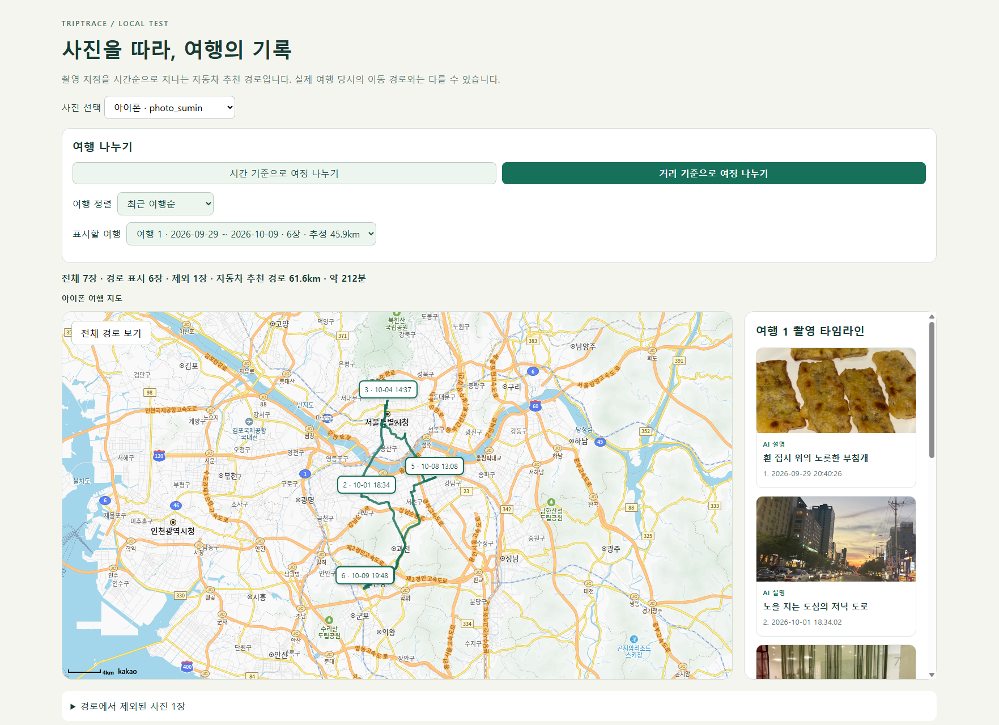
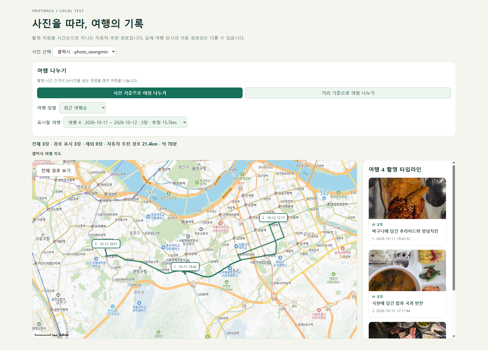
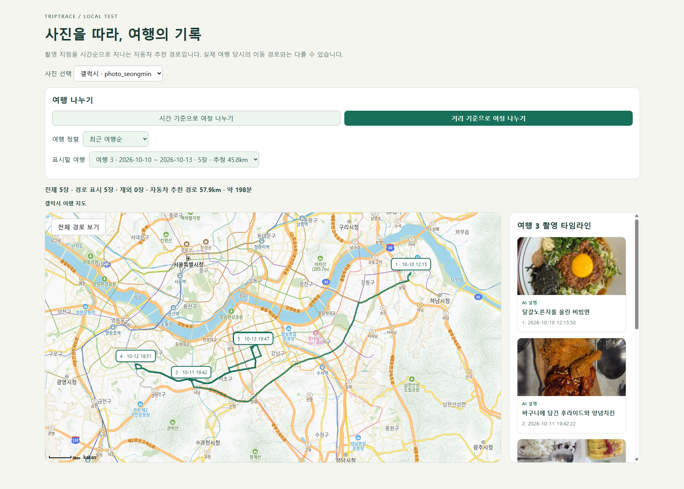
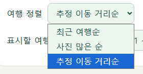
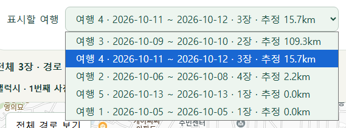
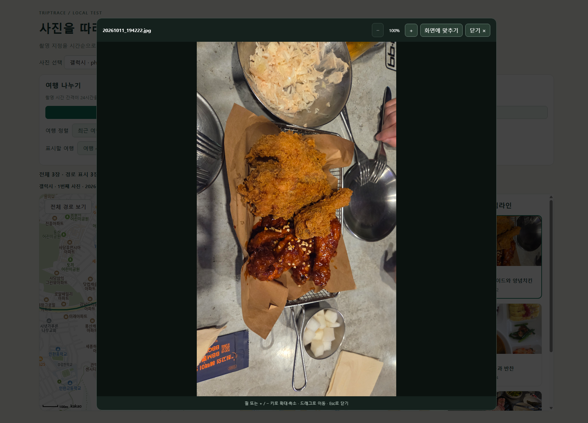
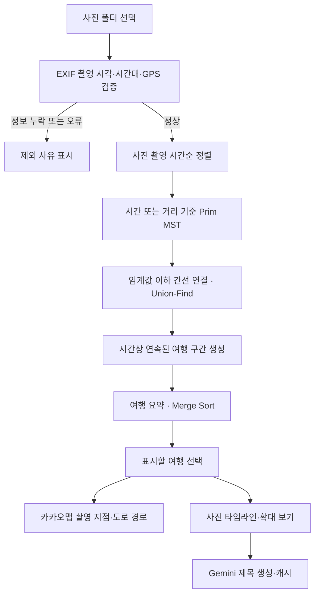

# TripTrace

**사진을 따라, 여행의 기록.**

TripTrace는 사진에 담긴 촬영 시간과 GPS를 읽어 여행을 자동으로 나누고, 촬영 지점과 경로를 지도에 보여주는 여행 기록 서비스입니다. 폴더에 섞인 사진을 여행별로 정리하고, 지도와 타임라인을 함께 보며 방문한 장소를 되돌아볼 수 있습니다.



[프로젝트 기획서](TripTrace.md) · [초기 기획](기획서.md)

## 팀원 및 역할

| 이름 | GitHub | 담당 알고리즘 |
| --- | --- | --- |
| 황성민 | [seongmini](https://github.com/seongmini) | Prim 기반 MST를 활용한 여행 자동 분리 |
| 심수민 | [SWWWin](https://github.com/SWWWin) | Merge Sort를 활용한 여행 목록 정렬 |

## 기획 의도

여행을 다녀온 뒤에는 사진이 남지만, 언제 어디를 어떤 순서로 방문했는지 다시 정리하기는 번거롭습니다. 여러 여행의 사진이 섞이면 여행별로 묶는 작업도 필요합니다.

TripTrace는 사진의 메타데이터를 여행 기록의 출발점으로 삼습니다. 시간·거리 관계로 여행을 구분하고, 원하는 기준으로 여행을 정렬한 뒤 촬영 순서에 맞춰 지도와 사진을 연결합니다.

## 주요 기능

| 기능 | 내용 |
| --- | --- |
| 사진 메타데이터 분석 | JPG에서 촬영 시각·시간대·GPS를 추출하고, 정보가 없는 사진은 제외 이유 표시 |
| 여행 자동 분리 | 시간 기준 또는 거리 기준으로 MST를 구성해 여행 구간 생성 |
| 여행 정렬·선택 | 최근 여행순, 사진 많은 순, 추정 이동 거리순으로 정렬하고 여행별 조회 |
| 지도·타임라인 연동 | 촬영 순서와 시각을 지도에 표시하고 사진 카드 선택과 연동 |
| 지도 사진 미리보기 | 날짜·시간 표식에 마우스를 올리면 표식 위치를 유지한 채 바로 위에 사진 표시 |
| 사진 확대 | 카드의 사진을 누르면 확대 뷰어, 설명 영역을 누르면 해당 위치만 선택 |
| 도로 경로 표시 | 선택한 여행의 촬영 지점을 순서대로 지나는 자동차 추천 경로·거리·시간 표시 |
| AI 사진 제목 | Gemini로 한국어 제목을 생성하고 사진 내용별로 캐시해 재사용 |

## 실행 화면

### 시간·거리 기준 여행 분리

시간 기준은 촬영 간격을, 거리 기준은 촬영 위치 간 거리를 사용합니다. 같은 사진 묶음도 선택한 기준에 따라 다른 여행 구간으로 나뉩니다.

| 시간 기준 | 거리 기준 |
| --- | --- |
|  |  |

### 여행 정렬과 선택

여행 목록을 원하는 기준으로 정렬하고, 기간·사진 수·추정 이동 거리를 확인해 표시할 여행을 선택합니다.





### 사진 확대 보기

사진을 클릭하면 크게 볼 수 있습니다. 휠 또는 `+` / `−` 키로 확대·축소하고, 확대 상태에서 드래그로 이동합니다. `Esc`로 닫을 수 있습니다.



## 적용 알고리즘

알고리즘 구현: [test/trips.mjs](test/trips.mjs)

### 1. Prim MST — 여행 자동 분리 · 황성민

사진을 정점으로, 두 사진 사이의 시간 차이 또는 거리를 간선 가중치로 표현합니다. 작은 가중치의 연결을 선택해 최소 신장 트리를 만들고, 기준을 초과하는 간선을 제거해 여행을 구분합니다.

1. 유효한 사진을 촬영 시각순으로 정렬합니다.
2. 선택한 모드에 따라 사진 쌍의 가중치를 계산합니다.
3. Prim 알고리즘으로 MST를 구성합니다.
4. 기준 이하의 간선만 Union-Find로 연결합니다.
5. 시간순으로 인접한 사진의 연결 그룹이 달라지는 곳을 경계로 여행 구간을 만듭니다.

| 모드 | 가중치 | 연결 유지 기준 |
| --- | --- | --- |
| 시간 | 두 사진의 촬영 시각 차이 ÷ 24시간 | 시간 차이 24시간 이하 |
| 거리 | 두 좌표의 Haversine 거리 ÷ 50km | 거리 50km 이하 |

사진이 `n`장일 때 Prim의 시간 복잡도는 **O(n²)**, 보조 공간은 **O(n)**입니다. 모든 간선을 저장하지 않고 필요한 가중치를 계산합니다. Union-Find는 유지할 간선으로 연결된 사진 그룹을 관리하며 경로 단축을 적용합니다.

모든 사진 쌍을 비교하는 밀집 그래프이므로 배열 기반 Prim을 사용했습니다. 간선 전체를 저장하는 대신 `used`, `best`, `parent` 배열로 방문 여부, 최소 연결 비용, 연결 대상을 관리합니다.

거리 모드는 촬영 시간 차이를 사용하지 않습니다. 가까운 지점을 거쳐 이어지는 사진들이 같은 그룹이 될 수 있으며, 최종 여행은 촬영 시간상 연속된 구간으로 표시합니다. MST는 여행을 나누는 데 사용하고, 지도 위 도로 경로는 카카오모빌리티 API로 표시합니다.

### 2. Merge Sort — 여행 목록 정렬 · 심수민

여행 목록을 절반씩 나누어 정렬한 뒤 병합하는 방식으로 구현했습니다. 여행별 요약 정보를 만든 후 선택한 기준으로 비교합니다.

입력 순서에 관계없이 O(k log k)의 정렬 성능을 유지하고, 같은 기준값을 가진 여행의 순서가 불필요하게 바뀌지 않도록 안정 정렬인 병합 정렬을 선택했습니다.

| 정렬 기준 | 비교 값 |
| --- | --- |
| 최근 여행순 | 마지막 사진의 촬영 시각 내림차순 |
| 사진 많은 순 | 여행에 포함된 사진 수 내림차순 |
| 추정 이동 거리순 | 촬영 순서에 따른 지점 간 거리 합계 내림차순 |

기준값이 같으면 최근 여행을 우선합니다. 병합 단계에서 비교 결과가 같은 경우 왼쪽 항목을 먼저 선택해 기존 순서를 유지합니다. 정렬 후에도 여행 ID와 여행 내부의 촬영 순서는 유지됩니다.

여행이 `k`개일 때 정렬의 시간 복잡도는 **O(k log k)**, 보조 공간은 **O(k)**입니다. 정렬 전 사진 `n`장의 여행별 요약 계산은 **O(n)**입니다.

### 3. Haversine — 좌표 간 거리 계산

위도·경도로 두 촬영 지점 사이의 구면 거리를 계산합니다. 거리 모드의 MST 가중치와 여행 정렬에 사용하는 추정 이동 거리 계산에 활용합니다. 좌표 쌍 하나의 계산은 **O(1)**입니다.

여행 목록의 **추정 이동 거리**는 촬영 지점 간 직선거리의 합이고, 지도의 **자동차 추천 경로 거리**는 도로를 따라 계산한 거리입니다.

## 처리 흐름



## 기술 구성

| 구분 | 기술 |
| --- | --- |
| 화면 | HTML, CSS, JavaScript ES Modules |
| 서버 | Node.js 22 이상, `node:http` |
| 사진 분석 | `exifr` 7.1.3 |
| 지도 | Kakao Maps JavaScript SDK |
| 도로 경로 | Kakao Mobility 다중 경유지 길찾기 API |
| 사진 제목 | Google Gemini API |
| 저장 | 로컬 사진 폴더, JSON 제목 캐시, 브라우저 localStorage |
| 테스트 | Node.js 내장 테스트 러너 |

## 실행 방법

### 1. 사진 준비

저장소 루트에 `photo_sumin/`, `photo_seongmin/` 폴더를 만들고 원본 JPG 사진을 넣습니다. 화면에서 읽을 폴더를 선택할 수 있습니다.

```text
triptrace/
├── photo_sumin/       # 아이폰 사진
├── photo_seongmin/    # 갤럭시 사진
├── .env
└── test/
```

필수 정보는 **촬영 시각, 시간대, GPS 좌표**입니다. 기종에 관계없이 이 정보가 남아 있으면 사용할 수 있습니다. 공유·전송 과정에서 GPS가 제거될 수 있으므로 위치 정보가 보존된 원본을 사용합니다. 현재 입력은 폴더 기반이며 JPG/JPEG를 지원합니다.

원본 사진 폴더는 Git에서 제외되어 있으므로 직접 준비해야 합니다. README의 화면 이미지는 `photosforreadme/`에 포함되어 있습니다.

### 2. 환경변수 설정

루트의 [.env.example](.env.example)을 `.env`로 복사하고 API 키를 입력합니다.

| 환경변수 | 용도 |
| --- | --- |
| `KAKAO_MAP_JAVASCRIPT_KEY` | 브라우저 지도 표시 |
| `KAKAO_REST_API_KEY` | 서버의 자동차 경로 조회 |
| `GEMINI_API_KEY` | 사진 제목 생성 |
| `GEMINI_MODEL` | 사용할 Gemini 모델 지정 |

카카오 JavaScript SDK 도메인에 `http://localhost:5173`을 등록합니다. `.env` 변경 후에는 서버를 재시작합니다.

### 3. 설치 및 실행

```sh
cd test
npm ci
npm start
```

브라우저에서 **http://localhost:5173**에 접속합니다. 설치 후에는 저장소 루트에서 `node test/server.mjs`로 실행할 수도 있습니다.

### 4. 화면 사용

1. 읽을 사진 폴더를 선택합니다.
2. 시간 또는 거리 기준으로 여행을 나눕니다.
3. 정렬 기준과 표시할 여행을 선택합니다.
4. 지도 표식에 마우스를 올려 사진을 미리 봅니다.
5. 카드 설명을 눌러 위치를 선택하거나, 사진을 눌러 확대합니다.

선택한 여행의 사진은 Gemini에 전송되어 제목을 생성합니다. 생성 결과는 사진 내용의 SHA-256 해시를 기준으로 `.cache/photo-titles/`에 저장해 재사용합니다. 도로 경로는 서버 메모리에 5분간 캐시합니다. `.env`, 원본 사진, 캐시, `node_modules`는 Git에서 제외합니다.

## 테스트

아이폰·갤럭시 원본 사진으로 메타데이터 분석부터 여행 분리·정렬까지 검증했습니다. 자동 분리 결과는 다음과 같습니다.

| 사진 묶음 | 입력 | 정상 처리 | 제외 | 시간 기준 여행 수 | 거리 기준 여행 수 |
| --- | --- | --- | --- | --- | --- |
| 아이폰 | 7장 | 6장 | 1장 | 5개 | 1개 |
| 갤럭시 | 11장 | 11장 | 0장 | 5개 | 3개 |

기능별 테스트 파일 5개가 모두 통과했습니다.

```sh
cd test
npm test
```

| 테스트 파일 | 검증 내용 |
| --- | --- |
| `photos.test.mjs` | 촬영 시간대 보존, 누락·손상된 시간 및 GPS 검증 |
| `trips.test.mjs` | 시간·거리 기준 여행 분리, 임계값 경계, 반복 방문, 여행 정렬과 안정성 |
| `routes.test.mjs` | 도로 경로 요청, 경유지 분할, 좌표 처리 및 API 오류 대응 |
| `descriptions.test.mjs` | AI 제목 생성, 재시도, 오류 처리 및 캐시 재사용 |
| `server.test.mjs` | 사진 폴더 선택, 여행 범위 검증, 파일 접근 제한 |

## 프로젝트 구조

```text
triptrace/
├── README.md
├── TripTrace.md            # 상세 기획서
├── 기획서.md               # 초기 기획
├── photosforreadme/        # 실행 화면 이미지
├── .env.example
└── test/
    ├── index.html          # 화면 구성
    ├── style.css           # 지도·타임라인·사진 뷰어 스타일
    ├── app.js              # 화면 이벤트와 여행 선택
    ├── server.mjs          # 로컬 서버와 API
    ├── photos.mjs          # EXIF 분석과 촬영 시간순 정렬
    ├── trips.mjs           # MST·Union-Find·Merge Sort·Haversine
    ├── routes.mjs          # 자동차 추천 경로
    ├── descriptions.mjs    # AI 사진 제목과 캐시
    └── *.test.mjs          # 기능별 테스트
```

## 향후 개선

- 사진 업로드 화면과 HEIC 지원
- GPS가 없는 사진의 위치 직접 지정
- 시간·거리 임계값 조절
- 여행 기록 저장 및 공유

지도에 표시하는 경로는 촬영 지점을 잇는 자동차 추천 경로이며, 실제 여행 당시의 이동 경로와는 다를 수 있습니다.
