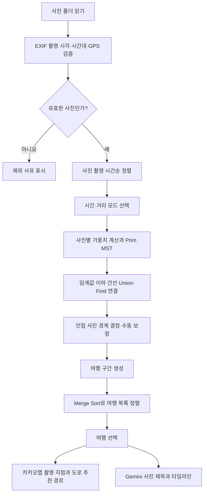

# TripTrace 알고리즘 적용 및 Enjoy Trip 프로젝트 결과 기획서

> 작성 기준: 2026-10-15
> 프로젝트: **TripTrace** — 사진 메타데이터 기반 여행 기록 및 경로 시각화
> 참여자: **seongmini, SWWWin**

## 1. 알고리즘 적용 기획서

### 1.1 프로젝트 개요

TripTrace는 여행 중 촬영한 사진의 **촬영 일시와 GPS 좌표(EXIF)** 를 활용하여 여러 여행을 자동으로 구분하고, 여행별 사진을 시간순으로 정리한 뒤 지도에 이동 지점을 시각화하는 서비스이다. 사진을 수동으로 정리하지 않아도 여행 기록을 되돌아볼 수 있도록 하는 것이 목표다.

### 1.2 문제 정의 및 기획 배경

- 여행 사진이 한 폴더에 섞여 있으면 각각 어느 여행에 속하는지 구분하기 어렵다.
- 사진을 촬영 순서대로 확인할 수 있어도 지도 위에서 장소 간 관계를 파악하기 어렵다.
- 촬영 간격이 길거나 지리적으로 떨어져 있는 사진은 같은 여행으로 묶지 않는 편이 자연스럽다.
- 여행이 여러 개로 분리되면 사용자는 날짜, 사진 수, 추정 이동 거리 등 다양한 기준으로 찾아보고 싶을 수 있다.

이 문제를 해결하기 위해 **그래프 알고리즘, 정렬 알고리즘, 집합 자료구조 및 거리 계산**을 조합한다.

### 1.3 핵심 알고리즘 및 적용 계획

| 알고리즘·기법                | 적용 목적                                             | 입력                              | 출력                      | 현재 상태               |
| ----------------------------- | ----------------------------------------------------- | --------------------------------- | ------------------------- | ----------------------- |
| Prim 기반 최소 신장 트리(MST) | 사진 사이 시간·거리 유사도를 이용한 여행 자동 그룹화 | 촬영 시간이 있는 사진 목록 및 GPS | 사진 연결 간선            | 구현됨                  |
| Union-Find                    | 기준 이하 MST 간선을 연결한 뒤 그룹 경계 판별         | MST 간선과 임계값                 | 사진 간 자동 경계         | 구현됨                  |
| Merge Sort                    | 여행 목록 정렬                                        | 여행별 요약 정보 및 정렬 기준     | 정렬된 여행 목록          | 구현됨                  |
| Haversine 공식                | 두 GPS 좌표의 구면 직선거리 추정                      | 위도, 경도                        | 거리(km)                  | 구현됨                  |
| 촬영 시간순 정렬              | 실제 촬영 시각 기준 타임라인 생성                     | EXIF 촬영 시각                    | 시간순 사진 목록          | 구현됨 (`Array.sort`) |
| 카카오모빌리티 길찾기 API     | 도로 기반 추천 이동 경로 표시                         | 선택된 여행의 GPS 지점            | 도로 폴리라인·거리·시간 | 구현됨 (외부 API 의존)  |

> **주의:** 카카오모빌리티 길찾기는 직접 구현한 최단 경로 알고리즘이 아니라 **외부 경로 탐색 API 활용 기능**이다. 본 프로젝트에서 직접 구현한 핵심 알고리즘은 MST, Union-Find, Merge Sort, Haversine 거리 계산이다.

### 1.4 알고리즘 상세 설계

#### A. 최소 신장 트리(MST) — Prim 알고리즘

**적용 이유:** 모든 사진 쌍의 시간 차이 또는 지리적 거리를 가중치로 표현하면 사진을 정점으로 하는 가중치 그래프를 만들 수 있다. Prim 알고리즘을 사용하여 작은 비용의 연결 관계를 우선 선택하고, 연결 비용이 큰 간선을 끊어 여행 그룹 구분의 기초 자료로 활용한다.

**동작 과정**

1. 유효한 사진 `n`장을 정점으로 간주한다.
2. 두 사진의 가중치를 선택 모드에 따라 계산한다.
   - **시간 모드:** `|촬영 시각 차이(ms)| / (24 × 3,600,000)`
   - **거리 모드:** `Haversine(두 GPS 좌표, km) / 50`
3. Prim 알고리즘으로 MST의 `n - 1`개 간선을 선택한다(사진이 한 장 이상일 때).
4. 간선 가중치가 `1` 이하인 연결만 Union-Find로 합친다.
5. 시간순으로 인접한 사진 `i-1`, `i`가 서로 다른 집합이면 자동 경계를 만든다.
6. 사용자의 수동 경계 선택을 최종적으로 적용하여 **연속된 시간 구간**을 여행으로 반환한다.

**자동 분리 기준**

| 모드 | 연결 유지 기준      | 자동 경계 판단                            |
| ---- | ------------------- | ----------------------------------------- |
| 시간 | 시간 차이 ≤ 24시간 | 인접 사진이 서로 다른 연결 집합일 때 분리 |
| 거리 | 직선거리 ≤ 50km    | 인접 사진이 서로 다른 연결 집합일 때 분리 |

**시간 복잡도:** 밀집 그래프용 Prim 구현은 `O(n²)`이며 `used`, `best`, `parent` 등 **Prim 자체의 보조 배열은 `O(n)`**이다. MST 간선 및 여행 경계 목록도 `O(n)`개 저장한다. 사진 쌍의 전체 거리 행렬은 미리 생성하지 않는다.

**설계상 유의점:** 거리 모드는 시간 차이를 고려하지 않으므로 같은 지역을 여러 번 방문했더라도 동일 연결 그룹으로 판단할 수 있다. 다만 최종 여행 목록은 시간상 연속 구간으로 나누므로, 비연속 방문이 화면에서 언제나 하나의 여행으로 합쳐지는 것은 아니다. 또한 이 알고리즘은 촬영 위치의 유사성을 바탕으로 분리할 뿐, 실제 이동 경로나 이동 수단을 추정하는 알고리즘은 아니다.

#### B. Union-Find — 연결 그룹 관리

**적용 이유:** MST의 간선 중 임계값 이하인 간선만 연결한 다음 두 사진이 같은 연결 그룹에 속하는지를 빠르게 판단하기 위해 사용한다.

**동작 과정:** 각 사진의 부모를 자기 자신으로 초기화 → 연결을 허용한 간선의 양 끝 정점을 합침 → 인접 사진 간 `find` 결과 비교 → 서로 다르면 여행 자동 경계 표시.

**구현 특징:** 경로 압축에 해당하는 경로 단축(path halving)을 적용했다. 별도의 rank/size 기준 합치기는 사용하지 않는다. 따라서 일반적인 두 최적화가 모두 적용된 Union-Find의 상각 `O(α(n))` 성능을 이 코드의 엄밀한 보장으로 표기하지 않는다. 전체 처리는 Prim의 `O(n²)`이 지배한다.

#### C. Merge Sort — 여행 목록 정렬

**적용 이유:** 여행이 여러 개일 때 재귀적 병합 정렬을 활용해 기준별로 일정한 성능으로 순서를 재배치한다.

**정렬 기준:**

- `recent`: 여행의 마지막 사진 촬영 시각이 최신인 순서
- `photos`: 여행에 포함된 사진 수가 많은 순서
- `distance`: 해당 여행의 연속 사진 간 Haversine 직선거리 합계가 큰 순서

같은 1차 기준값에서는 **최신 여행 우선**을 보조 비교 기준으로 사용한다. 병합 시 동률이면 왼쪽 원소를 먼저 선택해 안정적인 정렬을 수행한다.

**시간 복잡도:** 여행 개수가 `k`일 때 정렬 자체 `O(k log k)`, 병합 배열 사용량은 호출 스택을 제외한 최대 동시 보조 공간 기준 `O(k)`이다. 사전 여행 요약 계산은 전체 사진 수 `n`에 대해 `O(n)`이다.

#### D. Haversine — 사진 촬영 지점 간 거리 계산

두 위도·경도 사이의 대권거리(구면 위 최단거리)를 근사한다.

```text
Δφ = (위도₂ - 위도₁) × π / 180
Δλ = (경도₂ - 경도₁) × π / 180
a = sin²(Δφ/2) + cos(φ₁) × cos(φ₂) × sin²(Δλ/2)
d = 2 × 6371 × asin(√min(1, a))
```

- `d`의 단위는 km, 지구 반지름은 약 6,371km로 가정한다.
- **활용처:** 거리 모드 MST 가중치, 여행별 추정 이동 거리.
- **시간 복잡도:** 사진 쌍 하나당 `O(1)`.
- **한계:** 실제 도로를 따라 이동한 거리나 교통수단별 소요 시간을 의미하지 않는다.

### 1.5 전체 처리 흐름



### 1.6 예시 시나리오

사진 A·B가 동일 날짜에 촬영되었고 사진 C가 며칠 뒤 촬영되었다고 가정한다. 시간 모드의 MST 및 연결 그룹 계산에서 A·B가 연결되지만 C가 기준 밖에 있으면 두 여행으로 구분할 수 있다. 거리 모드에서는 촬영일이 떨어져 있더라도 사진 위치가 가까우면 연결 관계가 달라질 수 있다. 자동 분리가 사용자의 실제 여행 구분과 다를 경우, 사진 사이의 수동 경계를 체크하거나 해제해 조정한다.

### 1.7 기대 효과 및 검증 기준

| 평가 항목          | 검증 방법                             | 기대 결과                                   |
| ------------------ | ------------------------------------- | ------------------------------------------- |
| 자동 여행 분리     | 날짜·위치가 서로 다른 사진 묶음 입력 | 선택한 모드의 임계값에 맞춰 여행 구간 생성  |
| 경계 수동 조정     | 체크박스 선택·해제                   | 여행이 분리·합쳐지고 선택 결과 저장        |
| 여행 목록 정렬     | 최신순·사진 수순·거리순 전환        | 선택 기준에 따라 표시 순서 변경             |
| 거리 계산          | 알고 있는 GPS 좌표 쌍 검증            | Haversine 기반 추정 거리 산출               |
| 예외 처리          | EXIF 시간대 누락·GPS 오류 파일 입력  | 경로 생성에서 제외하고 이유 표시            |
| 지도·AI 실패 처리 | API 인증 실패·요청 실패 상황         | 이용자에게 오류를 보여주고 가능한 기능 유지 |

---

## 2. 알고리즘을 적용한 Enjoy Trip Project

### 2.1 서비스명 및 프로젝트 목표

**서비스명:** TripTrace
**주제:** 여행 사진의 메타데이터를 활용하여 여행을 자동 분류하고 지도 위에 기록하는 Enjoy Trip 서비스

일반적인 여행 계획 수립보다는 **여행 후 기록을 자동으로 재구성하는 경험**에 집중한다. 여행 사진만으로 방문 시점, 촬영 위치, 여행별 사진 타임라인을 확인할 수 있도록 설계했다.

### 2.2 구현 기술 및 실행 환경

| 구분                | 적용 기술                                                          |
| ------------------- | ------------------------------------------------------------------ |
| 프런트엔드          | HTML, CSS, JavaScript (ES Modules)                                 |
| 백엔드              | Node.js 22 이상, 기본 `node:http` 서버                           |
| 이미지 메타데이터   | `exifr` 7.1.3, EXIF                                              |
| 지도                | Kakao Maps JavaScript SDK                                          |
| 도로 기반 추천 경로 | Kakao Mobility 다중 경유지 길찾기 API                              |
| 사진 제목           | Google Gemini API                                                  |
| 알고리즘            | Prim MST, Union-Find, Merge Sort, Haversine                        |
| 저장                | 파일 시스템의 사진·제목 JSON 캐시, 브라우저 `localStorage` 설정 |
| 테스트              | Node.js 내장 테스트 러너 (`node --test`)                         |

**중요:** 업로드된 소스는 **Java가 아닌 JavaScript/Node.js 프로토타입**이다. 별도의 Java·Spring Boot 서버 또는 데이터베이스가 구현되었다고 볼 근거는 없다.

### 2.3 주요 기능과 구현 결과

| 기능                | 구현 내용                                                         | 상태                   |
| ------------------- | ----------------------------------------------------------------- | ---------------------- |
| 사진 읽기           | `photo_sumin/`, `photo_seongmin/` 폴더 선택 및 JPG 사진 로드  | 구현                   |
| EXIF 분석           | 촬영 일시, 시간대, GPS 확인 및 잘못된 사진 제외                   | 구현                   |
| 여행 자동 구분      | 시간·거리 모드별 Prim MST + Union-Find 적용                      | 구현                   |
| 여행 수동 조정      | 인접 사진 사이 경계 체크·해제, 경계 초기화                       | 구현                   |
| 여행 정렬           | 최신순, 사진 수순, 추정 거리순 Merge Sort                         | 구현                   |
| 여행 지도           | 카카오맵에 사진 촬영 지점 마커 및 순서 표시                       | 구현                   |
| 타임라인            | 사진 목록·촬영 일시·AI 제목 표시, 지도 선택과 연동              | 구현                   |
| 사진 확대 보기      | 사진 뷰어 확대·축소 및 이동                                      | 구현                   |
| 도로 경로           | 촬영 위치 순서에 따라 자동차 추천 경로 요청 및 표시               | 구현(API 설정 필요)    |
| 사진 제목 자동 생성 | Gemini에 이미지를 전송하여 짧은 한국어 제목 생성                  | 구현(API 설정 필요)    |
| 캐싱                | 제목은 SHA-256 내용 해시별 JSON 저장, 경로는 서버 메모리 5분 캐시 | 구현                   |
| 사진 업로드 UI      | 브라우저에서 임의 파일을 업로드해 영구 보관하는 기능              | 미구현(현재 폴더 기반) |
| 사용자 계정·DB     | 회원별 기록 저장·공유를 위한 기능                                | 미구현                 |

### 2.4 핵심 알고리즘의 실제 프로젝트 적용 위치

| 코드 파일                 | 담당 역할                                                           |
| ------------------------- | ------------------------------------------------------------------- |
| `test/trips.mjs`        | `distanceKm`, `mergeSort`, `sortTrips`, `segmentTrips` 구현 |
| `test/photos.mjs`       | EXIF 메타데이터 검증, 유효 사진 수집, 촬영 시간순 정렬              |
| `test/app.js`           | 모드 전환, 여행 선택·정렬, 경계 수동 조정, 지도·타임라인 UI       |
| `test/routes.mjs`       | 카카오모빌리티 도로 추천 경로 API 호출 및 결과 합산                 |
| `test/descriptions.mjs` | Gemini 사진 제목 생성, 재시도, SHA-256 캐시                         |
| `test/server.mjs`       | API 요청 처리, 사진 제공, 길찾기 요청과 캐시 관리                   |

### 2.5 사용자 이용 흐름

1. 개발 서버에 준비된 사진 폴더 중 한 개를 선택한다.
2. EXIF 시간·시간대·GPS가 유효한 JPG만 타임라인 대상으로 삼는다.
3. 시간 기준 또는 거리 기준의 여행 자동 분리 모드를 선택한다.
4. 필요에 따라 여행 경계를 직접 추가하거나 해제한다.
5. 여행 목록을 최근순·사진 수순·추정 거리순으로 정렬하여 하나를 선택한다.
6. 해당 여행의 촬영 지점, 촬영 시각, 사진 제목, 지도·타임라인을 확인한다.
7. API 설정이 유효하다면 촬영 지점 순서의 자동차 추천 도로 경로를 확인한다.

### 2.6 API 및 데이터 처리 설계

| API                                         | 메서드 | 기능                                                   |
| ------------------------------------------- | ------ | ------------------------------------------------------ |
| `/api/photos?source=...`                  | GET    | 사진 메타데이터 목록 및 제외 목록 반환                 |
| `/api/route?source=...&start=...&end=...` | GET    | 선택한 사진 범위의 자동차 추천 도로 경로 요청          |
| `/api/description?source=...&name=...`    | POST   | 선택한 이미지의 AI 제목 생성·조회                     |
| `/api/config`                             | GET    | 카카오맵 브라우저 SDK 구동에 필요한 JavaScript 키 반환 |

- **도로 경로:** 동일한 연속 좌표는 제거한다. 다중 경유지 요청은 **최대 30개 중간 경유지**로 나누어 호출한다. 성공한 경로는 동일 GPS 좌표 시퀀스 기준 **5분간 메모리에 캐시**한다.
- **AI 제목:** 이미지 콘텐츠의 SHA-256 해시를 식별자로 사용해 `.cache/photo-titles/`에 JSON으로 저장한다. 같은 내용의 이미지는 파일명이 달라도 캐시를 재사용할 수 있다.
- **개인 설정:** 사진 소스별 분리 모드·수동 경계 및 정렬 기준을 `localStorage`에 저장한다.
- **키 보안:** Gemini 및 Kakao Mobility REST API 키는 서버 환경변수를 사용한다. Kakao Maps JavaScript 키는 SDK 로딩 특성상 브라우저에 전달된다.

### 2.7 실행 방법

```bash
cd test
npm install
npm start
```

- 접속 주소: `http://localhost:5173`
- 별도로 Kakao Maps JavaScript SDK 사용 도메인에 `http://localhost:5173` 등록 필요.
- `GEMINI_MODEL` 미지정 시 서버 코드는 `gemini-2.5-flash-lite`를 사용한다.
- 테스트 명령: `cd test && npm test`

### 2.8 알고리즘 도입으로 달성한 결과

**① 여행 자동 분리의 기준을 명확히 정의함**
사진 간 단순 시간순 나열에서 더 나아가 MST의 연결 비용으로 여행을 나누며, 시간/거리 두 모드를 선택할 수 있도록 구현했다.

**② 자동화와 사용자 통제를 결합함**
자동 분리 결과가 실제 여행 경험과 다르더라도 인접 사진 사이의 경계를 수동으로 조정할 수 있다.

**③ 사진 기반 여행 탐색을 개선함**
Merge Sort로 정렬 기준을 다양화하고, Haversine 추정 거리를 여행 목록 정보로 제공한다.

**④ 알고리즘 결과를 UI에 연결함**여행을 선택하면 해당 구간의 사진만 지도, 타임라인, 도로 경로 요청에 적용되도록 연결했다.

> 위 내용은 **소스코드로 확인된 구현 결과**이다. 실제 운영 환경에서의 정확도, 평균 처리 시간, 사용자 만족도 등 **정량 성능 지표는 별도로 측정되지 않았다**.

### 2.9 제한 사항 및 개선 방향

| 현재 제한                                | 개선 제안                                                             |
| ---------------------------------------- | --------------------------------------------------------------------- |
| JPG 폴더 기반 입력                       | HEIC 등 이미지 형식 지원, 다중 업로드 UI 추가                         |
| 시간 24시간·거리 50km 고정              | 임계값을 사용자가 선택할 수 있는 설정 기능 추가                       |
| 거리 기준의 재방문 처리 한계             | 시간·거리를 함께 고려하는 결합 가중치 및 군집 품질 평가              |
| GPS 없는 사진은 제외                     | 수동 좌표 지정·보정 흐름 추가                                        |
| 여행 그룹의 연속 구간 기반 표현          | 동일 지역 재방문과 독립 여행 구분을 함께 다룰 그룹화 정책 연구        |
| 직선거리 기반 여행 거리                  | 도로 경로 거리와 직선거리의 구분을 강화하고 모드별 안내 추가          |
| 실제 여행 경로와 자동차 추천 경로의 차이 | 경로 표시를 '추정/추천 경로'로 명시, 실제 이동 기록(GPX 등) 연동 검토 |
| 데이터가 로컬 파일·브라우저에 저장됨    | 계정, 데이터베이스, 공유 링크, 클라우드 저장 기능 확장                |
| 외부 지도·AI API 의존                   | 오류 복구, 한도 초과 관리, 운영 비용 모니터링 강화                    |

### 2.10 향후 검증 계획

- **단위 테스트:** `trips.test.mjs`, `photos.test.mjs`, `routes.test.mjs`, `descriptions.test.mjs`, `server.test.mjs` 등 기존 테스트 파일을 활용한다.
- **성능 테스트:** 사진 수 `n`을 단계적으로 늘려 MST 수행 시간과 브라우저 반응 시간을 측정한다.
- **분리 정확도 검증:** 실제 여행별 정답 그룹을 수작업으로 구축한 뒤 시간/거리 모드의 분리 결과를 비교한다.
- **예외 검증:** EXIF 누락·중복 좌표·동일 시간·API 요청 오류·빈 사진 폴더 등의 시나리오를 테스트한다.
- **UX 검증:** 자동 분리 후 수동 경계 수정 횟수와 여행 검색 소요 시간을 확인한다.

### 2.11 결론

TripTrace는 **알고리즘을 실제 사용자 기능으로 연결한 Enjoy Trip 프로젝트**이다. Prim MST와 Union-Find로 사진들의 시간적·지리적 연결 관계를 분석하고, Merge Sort로 여행 탐색 편의성을 높이며, Haversine 거리 계산으로 위치 정보를 활용한다. 여기에 EXIF 분석, Kakao Maps·Mobility, Gemini AI를 결합해 **사진 정리 → 여행 자동 분리 → 여행 선택 → 지도·타임라인 회고**라는 사용자 흐름을 구현했다.

현재 결과물은 로컬 사진 폴더를 대상으로 하는 Node.js 기반 프로토타입이다. 향후 업로드·DB·사용자 계정 등을 구축하면 개인별 여행 기록 서비스로 확장할 수 있다.

---

## 부록. 근거 파일 및 해석 주의사항

- 프로젝트 설명: `README.md`, `test/README.md`
- 핵심 알고리즘: `test/trips.mjs`
- 사진 메타데이터: `test/photos.mjs`
- 지도·타임라인 UI: `test/app.js`, `test/index.html`
- 서버·API: `test/server.mjs`, `test/routes.mjs`, `test/descriptions.mjs`
- 테스트: `test/*.test.mjs`

**작성 원칙:** 제공된 코드에서 확인된 사항을 '구현'으로 표기했고, 사용자 업로드·계정·DB 등의 미확인 기능은 '미구현/개선 제안'으로 구분했다. 실측하지 않은 정확도·성능은 성과 수치로 주장하지 않았다.
